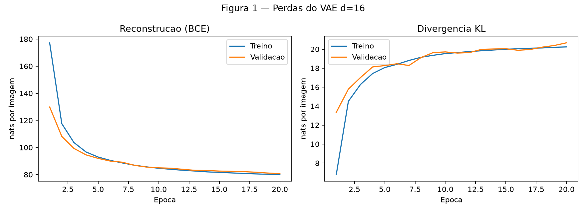
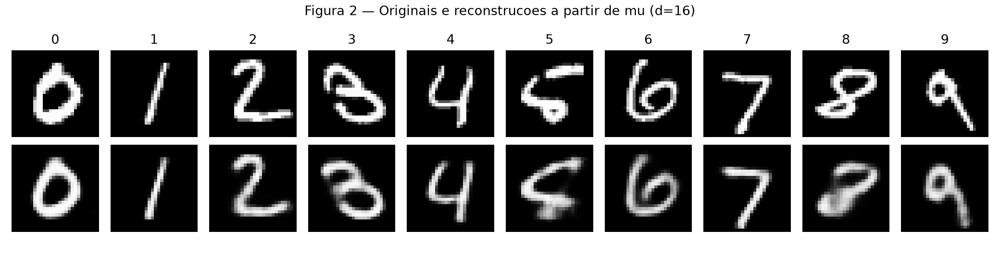
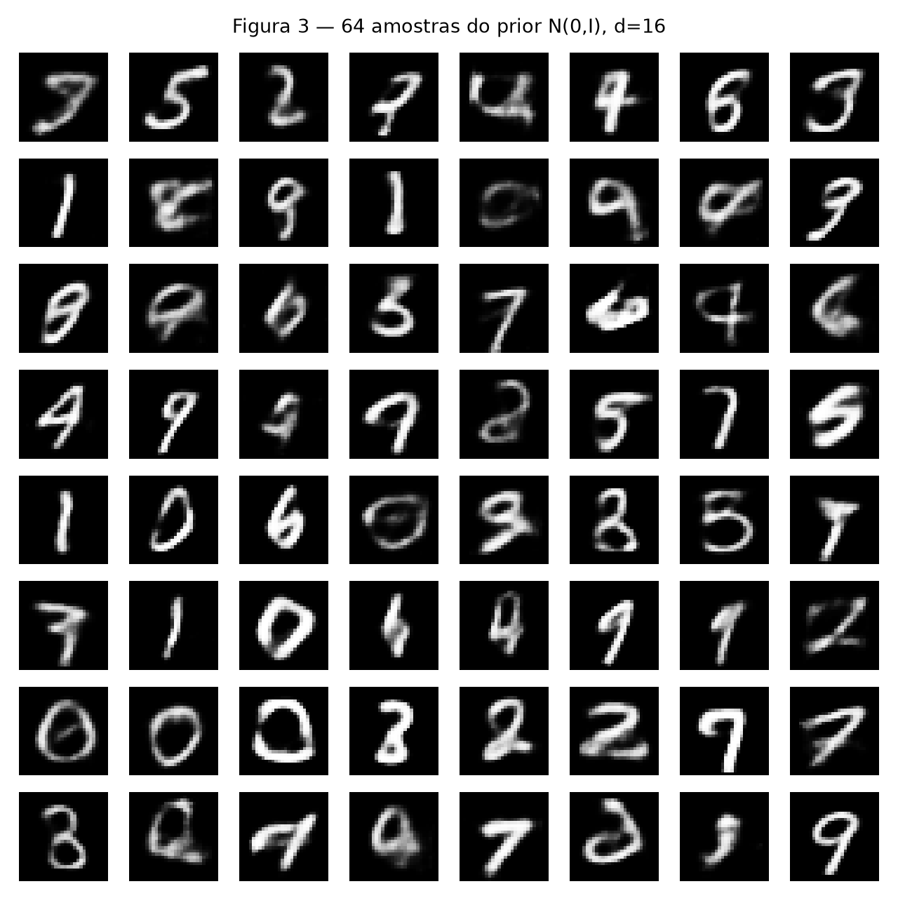
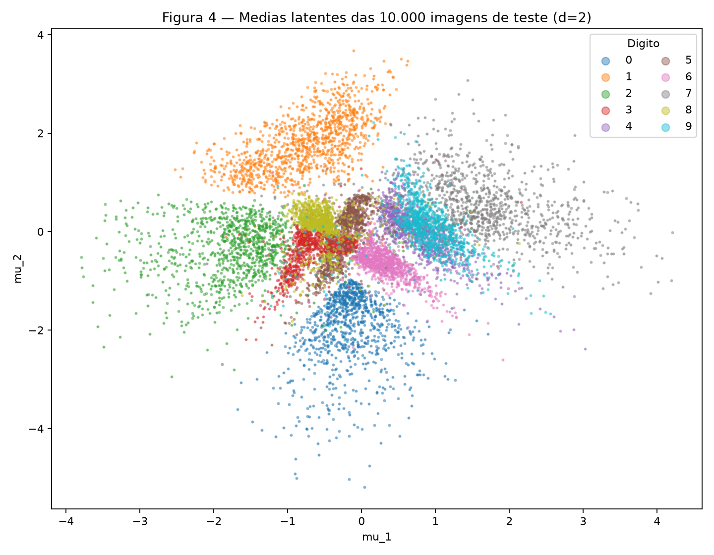
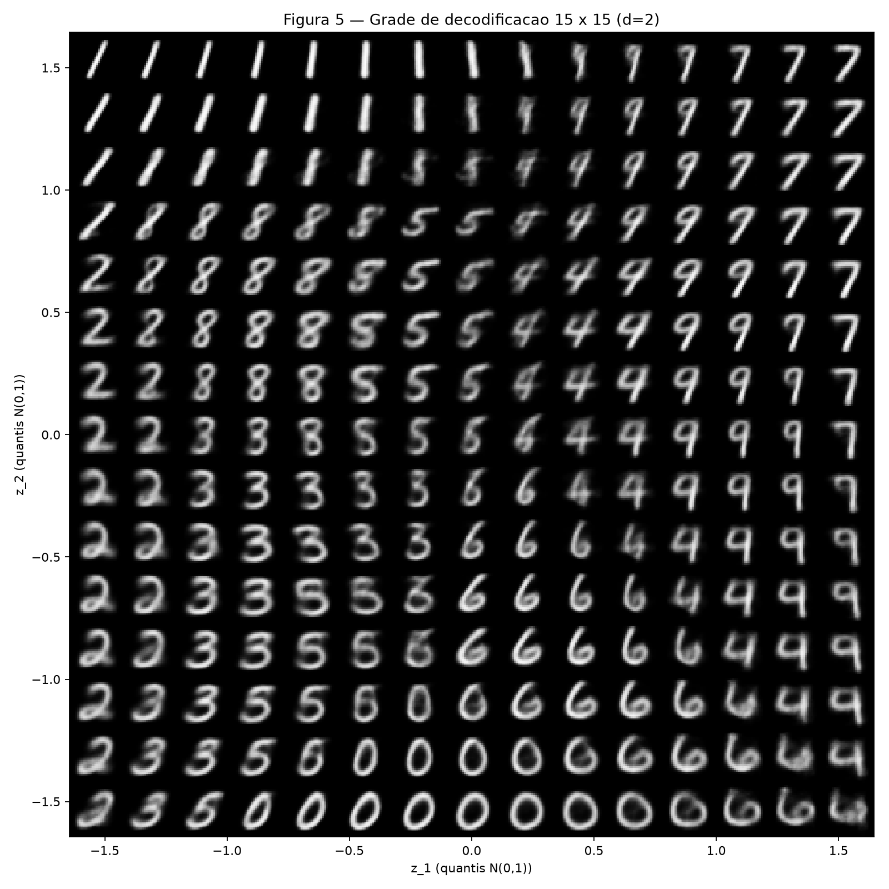
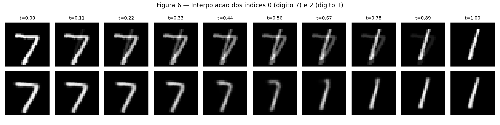

# Atividade 4 — Autoencoders Variacionais (VAE)

## Exercício 1

### A — Carregue e divida os dados

Utilizei `torchvision.datasets.MNIST`, `transforms.ToTensor()` e vetores de 784 pixels em `[0,1]`. Separei os 60.000 exemplos oficiais de treino em 50.000 de treino e 10.000 de validação, usando `random_split(..., generator=torch.Generator().manual_seed(42))`. Reservei as 10.000 imagens oficiais de teste para a avaliação final e as visualizações solicitadas.

```python
--8<-- "docs/exercises/vae/code/ex1a.py"
```


### B — Construa o modelo

O encoder é `784 → 512 → 256`, com ReLU, e produz duas cabeças `256 → d`: média `μ` e log-variância `log σ²`. O decoder é `d → 256 → 512 → 784`, com ReLU nas camadas ocultas e sigmoid na saída. Aqui, `d=16`, `β=1`.

A reparametrização é `z = μ + exp(0,5 log σ²) ε`, onde `ε ~ N(0,I)`. Calculo separadamente a BCE somada nos pixels e a KL fechada:

\[
\mathrm{BCE}=-\frac{1}{N}\sum_{n=1}^{N}\sum_{j=1}^{784}\left[x_{nj}\log \hat x_{nj}+(1-x_{nj})\log(1-\hat x_{nj})\right]
\]

\[
\mathrm{KL}=-\frac{1}{2N}\sum_{n=1}^{N}\sum_{i=1}^{d}(1+\log \sigma_{ni}^2-\mu_{ni}^2-\sigma_{ni}^2),\quad \mathcal{L}=\mathrm{BCE}+\mathrm{KL}.
\]


```python
--8<-- "docs/exercises/vae/code/ex1b.py"
```

### C — Treine

Treinei com Adam, taxa de aprendizado **0,001**, batches de **128** e **20 épocas**. Registrei reconstrução e KL em treino e validação, separadamente. No teste oficial, obtive **BCE = 79.981**, **KL = 20.691** e **ELBO negativo = 100.672 nats/imagem**.


```python
--8<-- "docs/exercises/vae/code/ex1c.py"
```



*Figura 1 — Evolução da reconstrução e da KL para o VAE de dimensão latente 16.*

### D — Reconstruções e amostras

Na Figura 2, cada coluna traz a primeira imagem de teste de um dígito (0 a 9) e sua reconstrução obtida ao decodificar **μ**, sem sortear `z`.


```python
--8<-- "docs/exercises/vae/code/ex1d.py"
```



*Figura 2 — Originais (acima) e reconstruções a partir de μ (abaixo).*

Na Figura 3, gero **64 amostras do prior N(0,I)**, em uma grade 8 × 8, depois de executar `torch.manual_seed(0)`.



*Figura 3 — Amostras novas decodificadas do prior gaussiano.*

### E — Análise

**1. Por que a KL pode subir enquanto a perda total cai?** O treinamento minimiza a soma `BCE + KL`. O encoder pode tornar os códigos mais informativos sobre cada imagem, reduzindo bastante a BCE, mesmo que isso afaste a posteriori aproximada do prior e aumente a KL. A troca compensa quando a queda na reconstrução é maior que o aumento na regularização. A KL de validação passou de **13.343** na primeira época para **20.674 nats/imagem** na última.

**2. Por que as amostras da Figura 3 podem parecer piores que as reconstruções da Figura 2?** Primeiro, nem toda região do prior necessariamente corresponde a códigos onde o encoder colocou exemplos de treino: amostras aleatórias podem cair em regiões pouco representadas e gerar imagens ambíguas. Segundo, o decoder prevê probabilidades de pixels; ao representar alternativas possíveis, seus valores intermediários podem produzir imagens borradas, sobretudo quando o código não identifica claramente um dígito.

**3. Por que decodificar μ na Figura 2?** Para reconstruir de modo determinístico a representação central de cada entrada. Amostrar `z` acrescentaria ruído e dificultaria a comparação entre a imagem de entrada e sua reconstrução.

## Exercício 2

### A — Treine um VAE 2-D

Repeti a arquitetura, a divisão, `β=1`, a semente `42` e as 20 épocas; a única alteração foi `d=2`. Os resultados finais no teste são:

| Dimensão latente | Reconstrução (nats/imagem) | KL (nats/imagem) |
|---|---:|---:|
| 16 | 79.981 | 20.691 |
| 2 | 134.121 | 6.746 |


```python
--8<-- "docs/exercises/vae/code/ex2a.py"
```


### B — O conjunto de teste codificado

A Figura 4 apresenta as médias `μ` das **10.000 imagens de teste**, usando cores e legenda para identificar cada dígito.


```python
--8<-- "docs/exercises/vae/code/ex2b.py"
```



*Figura 4 — Distribuição dos dígitos no espaço das médias latentes.*

### C — O plano decodificado

Na Figura 5, decodifiquei uma grade 15 × 15 com coordenadas `norm.ppf(q)`, onde `q` assume 15 valores igualmente espaçados entre `0,05` e `0,95`.


```python
--8<-- "docs/exercises/vae/code/ex2c.py"
```



*Figura 5 — Imagens geradas em diferentes regiões do plano latente.*

Como a transformação pela CDF leva uma normal padrão a uma uniforme, intervalos iguais de quantil correspondem a intervalos de mesma probabilidade em cada eixo (salvo as regiões externas aos quantis extremos exibidos).

### D — Interpolação

Escolhi os índices de teste **0 (dígito 7)** e **2 (dígito 1)**, que correspondem a dígitos diferentes. A Figura 6 compara dez passos lineares em pixels com dez passos entre `μ_a` e `μ_b`, decodificados pelo VAE de **16 dimensões**.


```python
--8<-- "docs/exercises/vae/code/ex2d.py"
```



*Figura 6 — Mistura direta de pixels (linha superior) e interpolação no espaço latente de dimensão 16 (linha inferior).*

### E — Análise

**1. Sobreposição de dígitos e transição no plano.** Na Figura 4, há sobreposição entre diferentes classes, por exemplo entre os dígitos **4 e 9** na região central do espaço latente, aproximadamente para valores de `μ_1` e `μ_2` entre 0 e 1. Na Figura 5, na região central-direita, observam-se formas que passam gradualmente de traços semelhantes ao 4 para traços semelhantes ao 9. Algumas imagens intermediárias misturam características dos dois dígitos, dificultando a identificação de uma única classe.

**2. Por que `d=2` reconstrói pior?** Com apenas duas dimensões latentes, o modelo precisa comprimir informações sobre a identidade dos dígitos e sobre o estilo de escrita, como curvatura, inclinação, espessura e posição dos traços. Parte dessas características é perdida ou não pode ser representada separadamente. Na Figura 5, as regiões de transição apresentam imagens com traços misturados ou borrados, evidenciando essa limitação. A reconstrução no teste foi de **134.121 nats/imagem** para `d=2`, contra **79.981 nats/imagem** para `d=16`, uma diferença de **54.139 nats/imagem**.

**3. Comparação entre as interpolações.** Na Figura 6, a interpolação em pixels (linha superior) faz uma sobreposição direta das imagens dos dígitos **7 e 1**. Nas etapas intermediárias, aparecem traços de ambos ao mesmo tempo, formando imagens ambíguas. Na interpolação latente (linha inferior), a transformação é mais coerente: o 7 perde gradualmente o traço superior e assume a forma do 1. Isso ocorre porque o decoder transforma representações intermediárias aprendidas em imagens com características de dígitos, enquanto a interpolação em pixels apenas mistura intensidades nas mesmas posições.

## Resumo dos resultados

| # | Quantidade | Valor |
|---|---|---|
| 1 | Ex. 1 — reconstrução, KL e ELBO negativo no teste (`d=16`) | 79.981; 20.691; 100.672 nats/imagem |
| 2 | Ex. 1 — KL de validação na primeira e na última época | 13.343; 20.674 nats/imagem |
| 3 | Ex. 2 — reconstrução e KL no teste (`d=2`) | 134.121; 6.746 nats/imagem |
| 4 | Ex. 2 — os dois índices de teste interpolados | 0 e 2 |
